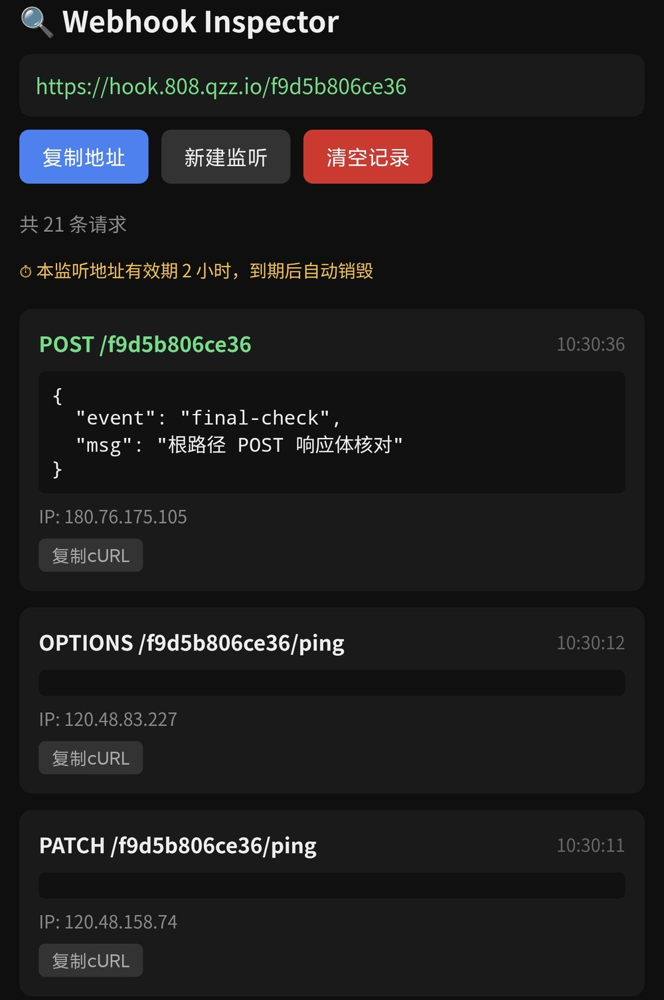

# Webhook Inspector

**一个“看完就烧”的 Webhook 调试面板：给你临时地址抓回调数据，1 小时自动销毁；管理员面板只输出计数，不包含请求内容。**


**在线直接用** → https://hook.808.qzz.io



---

## 为什么做这个

对接支付回调、机器人、第三方 API 的时候，最烦的就是一句话：

> “我们这边已经发出去了。”

到底发没发？发的是什么？Headers 对不对？Body 是不是少字段？

把本工具生成的临时地址填进对方的回调配置，对方一发，你屏幕上立刻显示完整请求。调试完关掉页面，数据到点自己消失。

**核心不只是“能抓包”，还有“抓完不留副本”。** 不少 webhook 调试工具会把请求存下来、记日志、给运营看；这个的设计是请求体只留在内存里，到点随实例一起清除。

---

## 隐私设计：内容不落盘，管理员面板只看计数

| 设计 | 怎么做的 | 效果 |
|---|---|---|
| **内容不落盘** | 请求体只存在 Durable Object 的内存数组里（上限 100 条，超出淘汰最旧），**不写入持久存储** | 持久层里没有请求内容 |
| **1 小时自毁（访问不续期）** | 创建时按 `createdAt + 1h` 注册闹钟，到点 `deleteAll()` 后写入 `expiredAt` 墓碑 | 到期即失效，后续请求一律 410；反复访问不会延长寿命 |
| **四层限流** | 监听总量 100、单 IP 10 分钟 10 个、单监听 10 次/秒·300 次/分、全站 60 次/秒·3000 次/分 | 防止被爬虫或压测打爆 |
| **实例级隔离** | 每个监听地址是一个独立 UUID + 独立 DO 实例 | 每个地址的数据各自独立 |
| **管理员面板不含内容** | `/admin` 只输出 4 个数字：总监听数、总请求数、今日新建、今日收到 | 站点主人看到的是计数，不含请求体 |
| **无内容日志** | 不写 console.log、不打请求体、不做审计留档 | 日志里也翻不到请求内容 |
| **黑名单静默丢弃** | 命中敏感关键词的请求直接 `return 200 OK`，不入库、不展示、不报错 | 拦截不会给请求方额外反馈 |

再直白一点：请求内容从接收那一刻起只在 DO 内存里停留，不落持久存储，管理员面板也不读取它。所以部署者手上没有可翻阅的副本，能看到的只有当时开着那个监听页面的你。

> 以上是本项目的实现思路，不是唯一做法。密钥/数据保管、访问审计这些环节还有不少可以做得更细的地方，欢迎提 issue 一起聊。

---

## 功能

- 一键生成临时监听地址（UUID），复制即用，无需部署
- WebSocket 实时推送，不用刷新页面
- 完整展示：方法、路径（含 query）、Headers、Body、来源 IP、时间
- JSON 自动格式化 + 语法高亮
- 一键复制成 cURL 命令，原地重放
- 一键清空当前记录
- 1 小时倒计时自动过期销毁（访问不续期，到期返回 410）
- 内置 84 条敏感词黑名单，**Body 与 Headers 一起扫描**，命中静默丢弃
- 四层限流：监听总量 / 单 IP 建监听频率 / 单监听 QPS / 全站 QPS
- `/admin` 统计面板（密码保护）
- 手机端适配

## 限流规则

| 层级 | 规则 | 超限返回 |
|---|---|---|
| 监听总量 | 同时活跃最多 **100** 个（1 小时内创建算活跃） | 429 页面 |
| 单 IP 建监听 | 每 10 分钟最多 **10** 个 | 429 页面 |
| 单监听请求 | **10 次/秒、300 次/分** | `429 {"scope":"hook_sec"}` + `Retry-After` |
| 全站请求 | **60 次/秒、3000 次/分** | `429 {"scope":"global"}` + `Retry-After` |

触发限流只影响当次请求，不进记录、不影响监听本身。

> 计数存在 Durable Object 内存里，实例回收后归零；对调试工具足够，若要精确计量请改用 Cloudflare Rate Limiting 绑定。

## 技术实现

```
Workers（入口路由）
  ├─ /            → 生成 UUID，跳转到监听页
  ├─ /<uuid>      → 转发到该 UUID 的 Durable Object 接收请求
  └─ /admin       → 密码保护，读 STATS 实例的四个计数器
Durable Object（每监听地址一个）
  ├─ requests[]   → 内存数组，最多 100 条，不落盘
  ├─ WebSocket    → 实时广播给页面
  └─ setAlarm     → createdAt + 1h 后 deleteAll() 并写 expiredAt 墓碑
Durable Object（STATS，单例）
  └─ 只累加计数：总数 / 今日数，按天切换
```

**单文件 27KB，零依赖零构建**，`wrangler deploy` 一步上线。没有 npm 依赖树，没有框架。

## 部署

```bash
npm i -g wrangler
wrangler login
wrangler deploy
```

需要两个 Durable Object 绑定（监听实例 `WEBHOOK_INSPECTOR` + 统计实例 `STATS`），以及一个变量 `ADMIN_PASSWORD`。

`ADMIN_PASSWORD` 用来访问 `/admin` 统计面板，**代码里不再硬编码任何密码**：

```toml
# wrangler.toml
[vars]
ADMIN_PASSWORD = "换成你自己的密码"
```

不配置这个变量时，`/admin` 一律返回 401（拿不到密码就无法进入），不会退化成默认密码。

## 用法

1. 打开 https://hook.808.qzz.io ，自动生成一个监听地址
2. 把这个地址填进对方系统的回调配置
3. 触发回调，页面实时显示完整请求
4. 调试完关掉页面，2 小时后自动销毁

```bash
curl -X POST https://hook.808.qzz.io/<你的UUID> \
  -H "Content-Type: application/json" \
  -d '{"event":"test","data":"hello"}'
```

## 免责声明

本项目仅用于合法的开发调试用途。不得用于接收、存储或分析非法获取的数据，不得用于未授权网络探测、流量劫持、钓鱼诈骗、规避监管等违法违规活动。

监听地址不设鉴权：任何获得该地址的人都可以向其发送请求并读取已捕获的记录。请勿将本工具用于生产环境，或用于承载账号口令、支付凭证、身份信息等真实敏感数据。调试涉及第三方数据的接口前，应确认已取得合法授权与必要告知。

请求内容自接收起仅存在于对应 Durable Object 的内存中，不写入持久存储，并在创建 1 小时后随实例一并销毁；作者不保留副本，也无从读取。但内存不落盘不等于数据无害：使用者仍需自行对调试期间接触到的数据承担保密义务。

本软件按现状提供，不附带任何明示或默示担保，包括但不限于适销性、特定用途适用性与不侵权担保。因部署、配置、使用或无法使用本软件引起的任何直接或间接损失、数据泄露、业务中断、第三方索赔或行政处罚，作者不承担责任。

作者无义务提供技术支持、漏洞修复或版本更新，并保留随时修改本声明及本项目的权利。声明修改后继续使用，即视为接受修改后的条款。

## License

MIT · Copyright (c) 2026 摸鱼基地出品（匿名爱好者）

可自由使用、修改、分发、商用，保留署名即可；软件按现状提供，风险自担。详见 [LICENSE](./LICENSE)。
